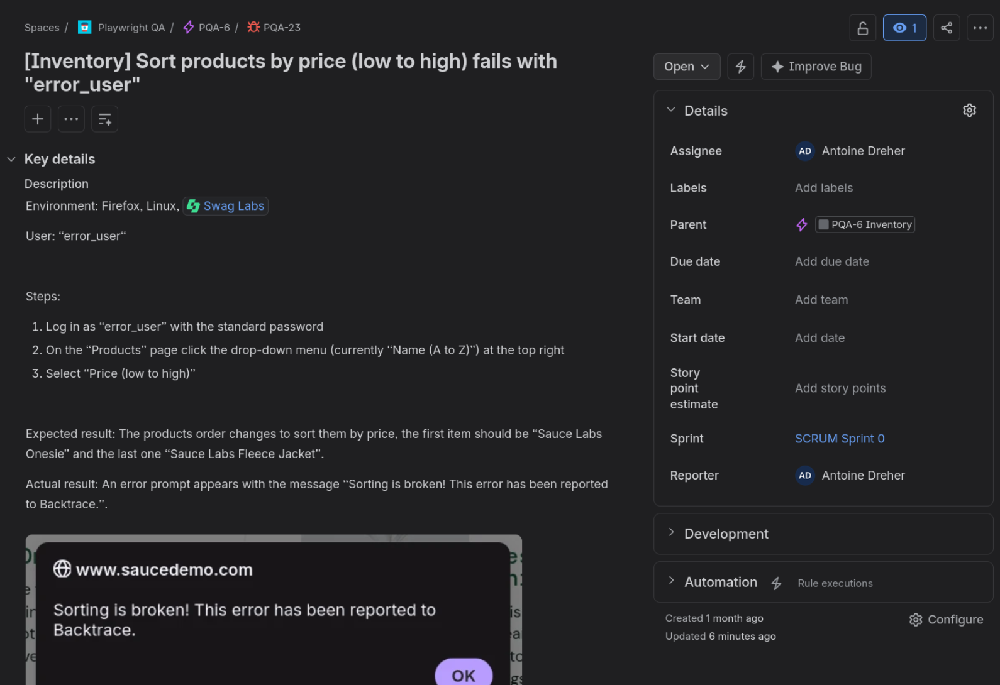
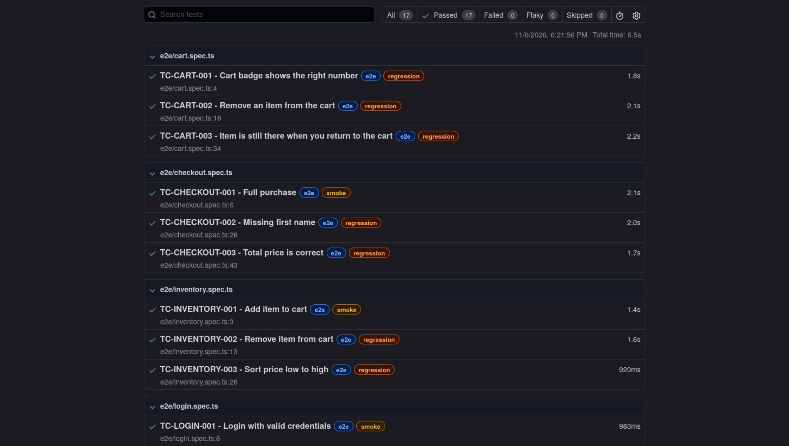
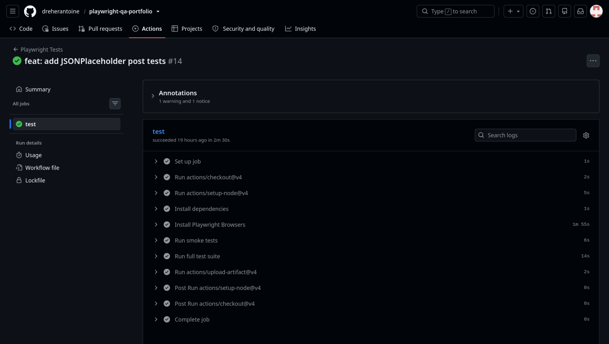
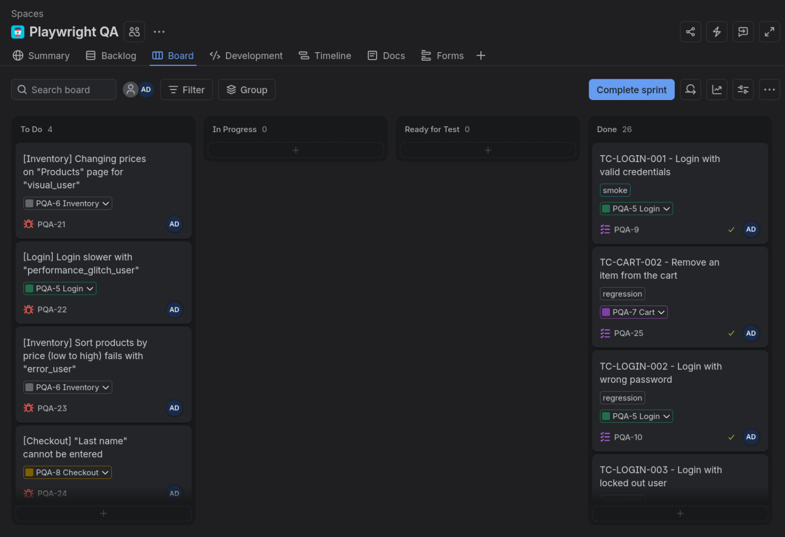

# Playwright QA Portfolio

[](https://github.com/dreherantoine/playwright-qa-portfolio/actions/workflows/playwright.yml)

QA automation portfolio: Playwright + TypeScript E2E on SauceDemo and API tests on JSONPlaceholder, with Page Object Model, smoke/regression tags and a GitHub Actions CI.

Targets are public demo sites built for practice:
- [SauceDemo](https://saucedemo.com): web shop (E2E)
- [JSONPlaceholder](https://jsonplaceholder.typicode.com): fake REST API

## Tech stack

- **Playwright** with **TypeScript** (E2E and API tests)
- **Page Object Model**, **fixtures** for the login setup
- **GitHub Actions** for CI with branch protection on `main`
- **Jira** for test cases, bug tracking, board, and dashboard

## How to run

Requirements: Node.js and Git.

```bash
git clone https://github.com/dreherantoine/playwright-qa-portfolio.git
cd playwright-qa-portfolio
npm ci
npx playwright install firefox
```

| Command | What it does |
| --- | --- |
| `npm test` | Run all tests |
| `npm run test:e2e` | Run browser tests |
| `npm run test:api` | Run API tests |
| `npm run test:smoke` | Run tests tagged `@smoke` |
| `npm run test:regression` | Run tests tagged `@regression` |
| `npx playwright show-report` | Open HTML report |

## Bug reports

Found through exploratory testing with SauceDemo's intantionally faulty users. Bugs are built into the app which is why they remain open. Full tickets with the steps, expected/ctual results, and screenshots are in the private Jira project.

| Jira ID | Title | Severity | Priority |
| --- | --- | --- | --- |
| PQA21 | [Inventory] Changing prices on "Products" page for "visual_user" | Major | P1 (High) |
| PQA22 | [Login] Login slower with "performance_glitch_user" | Minor | P3 (Low) |
| PQA23 | [Inventory] Sort products by price (low to high) fails with "error_user" | Minor | P2 (Medium) |
| PQA24 | [Checkout] "Last name" cannot be entered | Critical | P0 (Immediate) |



## Results



## CI

On every pull request and push to `main` smoke tests run first, then the full suite.



## Jira

Test cases and bugs are tracked in a private Jira project.



## License

MIT
